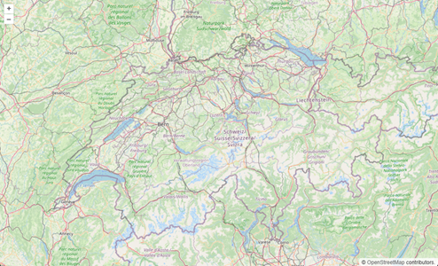
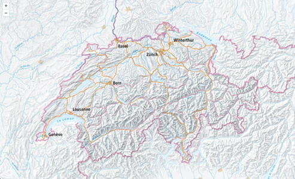
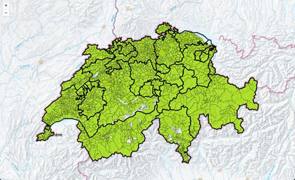
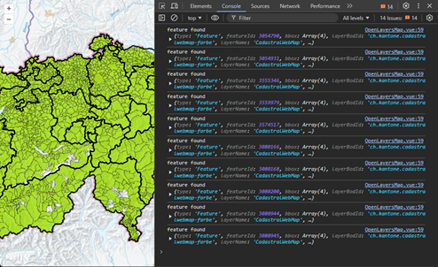
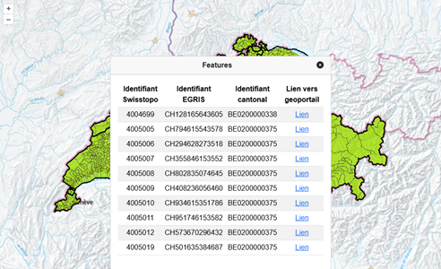

# Exercice sur geoadmin

## Mise en place

Afin de réaliser cet exercice, vous devez commencer par clone ce projet sur votre machine locale.

Ouvrez ensuite un terminal pointant dans le dossier que vous venez de créer avec le code de ce projet. (ou ouvrez simplement le terminal depuis VS Code après avoir ouvert le projet, il pointera directement au bon endroit)

### 1. Installer les librairies

```bash
npm install
```

### 2. Lancer le projet localement


```bash
npm run serve
```

En ouvrant l'URL qui est proposé par npm dans le terminal, vous devriez arriver sur une carte de la Suisse avec les tuiles OpenStreetMap



## Etape 1 : changer la carte de fond



Modifier `src/OpenLayersMap.vue` et changer le fond OpenStreetMaps par la carte de fond utilisée sur https://map.geo.admin.ch
Vous trouverez dans le fichier `src/swisstopo/swisstopoLayersUtils.js` des fonctions vous aidant à créer les objets OpenLayers pour des couches fournies par swisstopo.

### Trouver l'identifiant d'une couche

Afin de trouver l'identifiant d'une couche, vous pouvez ajouter celle-ci sur https://map.geo.admin.ch puis regarder le contenu du paramètre d'URL `layers` (ou `bgLayer` si c'est la carte de fond qui vous intéresse).
Il est aussi possible de parcourir tous les identifiants de layers (ainsi que leur titre en anglais et le type de chaque layers) sur [l'aide de geoadmin](https://sys-api3.dev.bgdi.ch/api/faq/index.html#which-layers-are-available)

## Etape 2 : ajouter le cadastre sur la carte



Trouvez par quel ID la carte du cadastre est identifier, et ajouter celle-ci par dessus la carte de fond.  

## Etape 3 : identifier les objets sous un clic de souris



Ouvrez votre console Javascript (si ce n'était pas déjà le cas) et faites en sorte qu'un clic de souris sur la carte lancer une requête auprès des services de swisstopo pour savoir quels sont les objets aux coordonnées du clic.
Pour vous aider dans cette opération, vous pouvez utiliser la fonction dans le fichier `src/swisstopo/swisstopoIdentifyUtils.js`

Documentation pour vous aidez sur ce point :

https://openlayers.org/en/latest/apidoc/module-ol_Map-Map.html

https://gis.stackexchange.com/questions/423001/click-on-the-openlayers-map-to-return-the-correct-x-and-y-coordinates

## Etape 4 et finale : afficher les objets trouvés par le clic de souris sous forme HTML



Utilisez les objets que vous avez reçu en étape 3 et générez du HTML avec. Pour vous aider, il y a déjà un composant Vue.js capable d'afficher ce que produit la fonction utilitaire de `src/swisstopo/swisstopoIdentifyUtils.js`, il se trouve dans le fichier `src/FeatureList.vue`


# Solutions pour chaques étapes

Pour avoir une solution pour chaque étapes, vous pouvez consultez les branches correspondantes (sur github.com ou localement).

* Etape 1 : `step-1` --> `git checkout step-1`
* Etape 2 : `step-2` --> `git checkout step-2`
* Etape 3 : `step-3` --> `git checkout step-3`
* Etape 4 : `step-4` --> `git checkout step-4`
